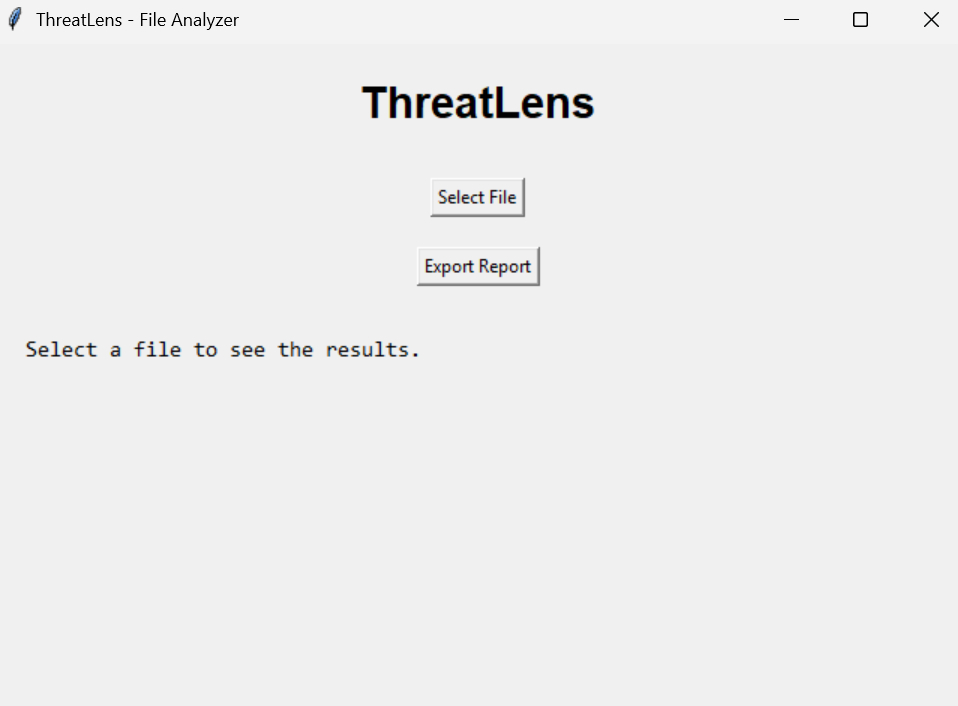
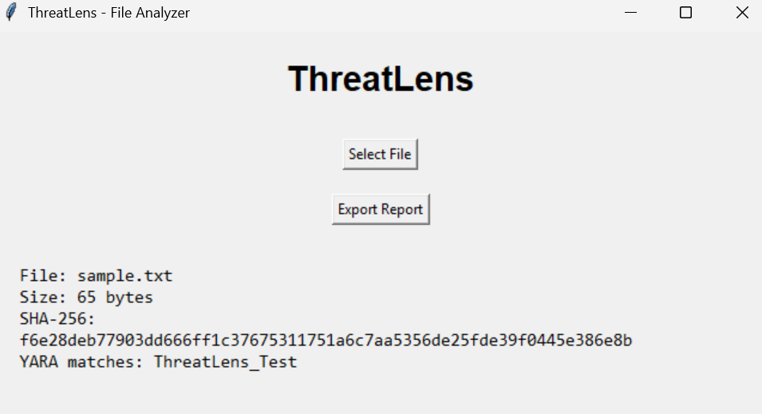

# ThreatLens

**Static File Analyzer | Python · YARA · Tkinter · pytest**

ThreatLens is an educational desktop application for static file analysis. It inspects selected files **without executing them**, calculates SHA-256 hashes, checks for matches against a demonstration YARA rule, and presents the results in a Tkinter interface. Analysis results can also be exported as JSON.

> **Important:** ThreatLens is a learning project, **not an antivirus**. A file with no YARA matches is **not necessarily safe**.

## Screenshots

### Main Interface

The ThreatLens desktop application allows users to select a file
and export analysis reports in JSON format.



### File Analysis with YARA

ThreatLens displays file metadata, SHA-256 hashing results,
and YARA rule matches.

The example below uses a harmless test signature,
not actual malware.



## Features

- **File inspection:** Display the selected file's name and size in bytes.
- **SHA-256 fingerprinting:** Compute a reproducible hash of the file contents.
- **YARA rule matching:** Identify patterns using the included laboratory rule.
- **Desktop interface:** Select a file and view results using Tkinter.
- **JSON export:** Save the last successful analysis as a structured report.
- **Automated tests:** Check file analysis, positive and negative YARA cases, and nonexistent-file handling with pytest.
- **Basic error handling:** Report missing or unreadable files and YARA failures.

## Tech Stack

Python · `pathlib` · `hashlib` · `yara-python` · Tkinter · JSON · pytest · Git

## Getting Started (Windows)

**Requirements:** Python 3 and Git. The current version has been tested on Windows.

1. Clone the repository:

   ```powershell
   git clone https://github.com/PengwinKingdom/ThreatLens.git
   cd ThreatLens
   ```

2. Create a virtual environment:

   ```powershell
   python -m venv .venv
   ```

3. Install dependencies:

   ```powershell
   .\.venv\Scripts\python.exe -m pip install -r requirements.txt
   ```

4. Launch the desktop application:

   ```powershell
   .\.venv\Scripts\python.exe gui.py
   ```

5. Select a small, harmless file to analyze. Use **Export Report** to save the analysis as JSON if needed.

## Running Tests

From the project directory, run:

```powershell
.\.venv\Scripts\python.exe -m pytest -v
```

The current suite contains **four automated tests**, covering:

1. Basic analysis output: file name, size, SHA-256 format and YARA match list.
2. Positive YARA match for a known test marker.
3. Negative YARA match when the marker is absent.
4. Handling a missing file.

The four tests passed in the development environment and in a fresh local clone on Windows. Passing these tests does not establish comprehensive malware-detection capability.

## YARA Demonstration

The included file `rules/test_rule.yar` defines the rule `ThreatLens_Test`, which looks for this **harmless laboratory marker**:

```text
THREATLENS_TEST_SIGNATURE
```

To reproduce a positive result, place that marker in `sample.txt`, save the file, and select it in the GUI. Remove the marker to test a case without matches.

This rule demonstrates signature matching; **it does not identify real malware**.

## Example JSON Report

The values below are illustrative, not taken from a real scan:

```json
{
  "file_name": "sample.txt",
  "file_size": 68,
  "sha256": "<64-character SHA-256 hexadecimal hash>",
  "yara_matches": ["ThreatLens_Test"]
}
```

## Current Limitations

- The included YARA rule is for demonstration, not real-world malware classification.
- No YARA match **does not** mean a file is safe.
- ThreatLens does not execute files or perform behavioral/dynamic analysis.
- Very large files and unusual file formats have not been thoroughly tested.
- Cross-platform functionality has not been verified; instructions focus on Windows.
- The project currently has a small automated test suite, not comprehensive security testing.

## Possible Future Improvements

- Add well-documented YARA rules and explain their limits and potential false positives.
- Identify file formats from their actual contents, not only their extensions.
- Improve handling of large files and add additional test coverage.
- Refine the interface and exported report format.

## Project Purpose

ThreatLens was built to practice **Python development, cybersecurity fundamentals, file analysis, desktop GUI development, and software testing** through a reproducible project.
